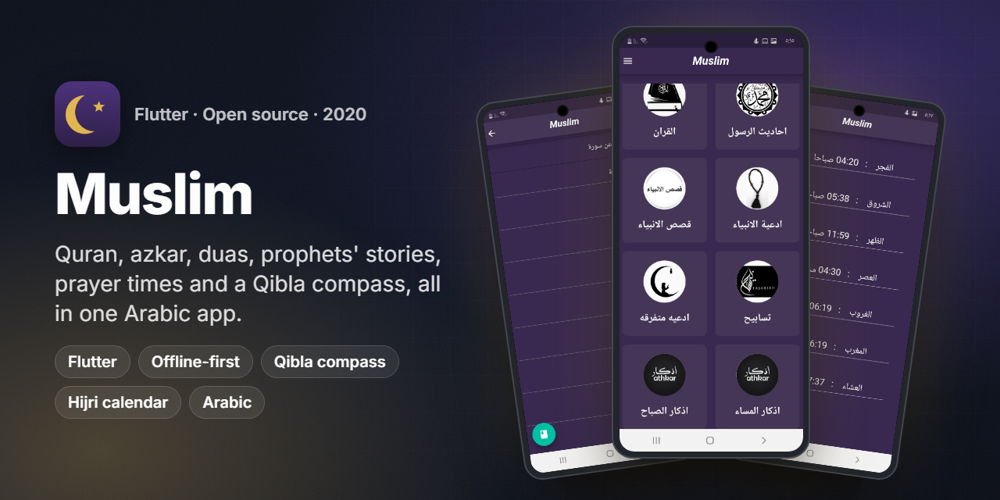
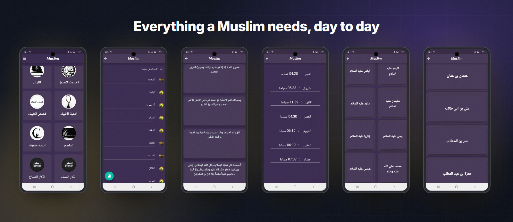
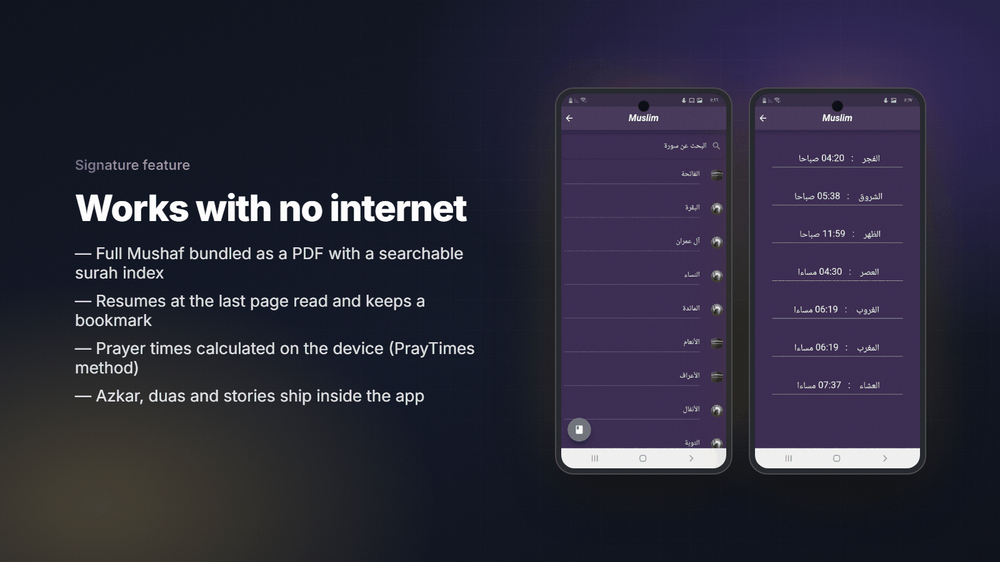
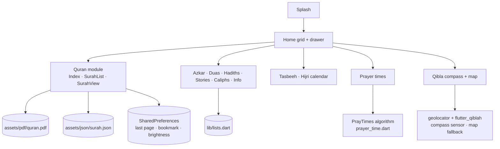

<p align="center"></p>
<h1 align="center">Muslim</h1>
<p align="center"><b>Quran, azkar, duas, prophets' stories, prayer times and a Qibla compass, in one offline Flutter app.</b></p>
<p align="center">
  
  
  
  
  
  
</p>

## Overview

**Muslim** is an Islamic companion app that puts the daily essentials in one place: the Holy Quran, the Prophet's hadiths,
morning and evening azkar, duas, prophets' and companions' stories, an electronic tasbeeh counter, a Hijri calendar,
prayer times and a Qibla compass. It works **without an internet connection**: all texts and the Mushaf ship inside the app.

| | |
|---|---|
| **Audience** | Arabic-speaking Muslims |
| **My role** | Solo developer: idea, UI and Flutter implementation, Play Store release |
| **Timeline** | 2020 (one of the author's first published Flutter apps) |
| **Store ID** | Published on Google Play as `com.anashaker.islam` (listing no longer available) |

## The challenge

- Users had to keep **several single-purpose apps** (Quran, azkar, prayer times, Qibla) on their phones.
- Many of those apps needed an internet connection or were full of ads. The goal was a **simple, offline, ad-free** app.
- Arabic religious text needs **right-aligned layout and clean typography** to stay readable.

## Highlights

**📖 Quran**
- Full Mushaf bundled as a PDF (`native_pdf_view`) with a surah index loaded from `assets/json/surah.json`
- Search by surah name
- Resumes at the **last page read**, with a **bookmark** you can jump back to
- Keeps the screen awake and remembers the reading brightness (`screen` plugin)

**🤲 Azkar & duas**
- Morning azkar, evening azkar and general azkar
- Prophets' duas, assorted duas and duas for the deceased
- Tasbeeh phrases and a list of the Prophet's hadiths

**📚 Stories & knowledge**
- Prophets' stories (from Adam to Muhammad ﷺ) and stories of the companions and caliphs
- General Islamic information

**🧭 Tools**
- **Prayer times** calculated on the device with the PrayTimes algorithm (no API)
- **Qibla compass** (`flutter_qiblah` + `geolocator`) with a location-error state, and a map fallback on devices without a compass sensor
- **Hijri calendar** with an Umm al-Qura date picker (`hijri_picker`)
- **Electronic tasbeeh** counter with haptic feedback (`vibration`)

## Screens

<p align="center"></p>
<p align="center"><sub>Home, Quran index, duas, prayer times, prophets' stories and the companions, from the released app.</sub></p>

## Signature feature

<p align="center"></p>

The whole app works offline:

1. **Quran:** the Mushaf is a bundled PDF. `SurahListBuilder` maps each surah to its page, and `SurahViewBuilder` opens the PDF at that page.
   It saves `lastViewedPage` and `bookmarkedPage` in `SharedPreferences` so the reader can continue where they stopped.
2. **Prayer times:** [`prayer_time.dart`](lib/prayer/util/prayer_time.dart) implements the astronomical PrayTimes method
   (calculation method, Asr juristic method, high-latitude adjustment, per-prayer offsets). It needs only coordinates and a time zone, with no network call.
3. **Texts:** azkar, duas, hadiths and stories are Dart lists in [`lists.dart`](lib/lists.dart), so they load instantly with no database.

## Architecture & stack



| Layer | Tech (from `pubspec.yaml`) |
|---|---|
| UI | Flutter (Material), custom purple theme, `flutter_svg`, `flutter_splash` |
| State | `StatefulWidget` + `setState` |
| Quran reader | `native_pdf_view`, `screen` (brightness / keep-awake), `shared_preferences` |
| Prayer times | Pure Dart PrayTimes implementation |
| Qibla | `flutter_qiblah`, `geolocator`, `google_maps_flutter` |
| Calendar | `hijri_picker` (Umm al-Qura) |
| Device | `vibration`, `device_info`, `flutter_local_notifications` |

## Engineering notes

- **Offline by design.** No backend and no API keys: the Mushaf, the surah index and all texts are bundled assets, so the app opens instantly and works anywhere.
- **Reading continuity.** The Quran reader saves the last viewed page and the bookmark in `SharedPreferences`. A floating button on the index ("الانتقال الى العلامة") jumps straight to the bookmark.
- **Sensor-driven Qibla.** The app first checks whether the device has a compass sensor and shows the map fallback if it does not. The compass checks location status through a `StreamController<LocationStatus>` and shows a retry widget instead of a broken compass.
- **Configurable prayer location.** The prayer-time location is a build-time setting (`PRAYER_LAT`, `PRAYER_LONG`, `PRAYER_TZ`, default Cairo), so you can build a version for any city without code changes.

## Getting started

> This is a **2020 codebase** written on **Flutter 1.x** (`sdk: ">=2.1.0 <3.0.0"`, pre-null-safety).
> It does not resolve on Flutter 3 / Dart 3 without a null-safety migration and plugin upgrades.
>
> **Verified:** with Flutter **2.10.5**, `flutter pub get` resolves and `flutter analyze` reports **0 errors and 0 warnings** (54 info-level lints).
> Android still uses the v1 embedding, so `flutter run` needs Flutter 1.22–2.x.

```bash
# Use a Flutter 1.22–2.10 SDK (for example with fvm)
fvm install 2.10.5 && fvm use 2.10.5
fvm flutter pub get
fvm flutter run --dart-define=PRAYER_LAT=30.0444 --dart-define=PRAYER_LONG=31.2357 --dart-define=PRAYER_TZ=2
```

For the Qibla **map** view, add your Google Maps key to `android/app/src/main/AndroidManifest.xml`
(`com.google.android.geo.API_KEY`) and to `ios/Runner/AppDelegate.swift`. Never commit the real key.

Release signing reads an optional `android/key.properties`, which is git-ignored. Without it the app builds with the debug key.

## Project structure

```
lib/
├── main.dart                 # Splash, home grid, drawer
├── lists.dart                # Azkar, duas, hadiths, stories, caliphs (content)
├── azkar*.dart · adaya.dart · ahades.dart · DeadDoaa.dart · tasabyh.dart
├── story.dart · kholafa.dart · malomat.dart
├── sebha.dart                # Electronic tasbeeh
├── Takwim.dart               # Hijri calendar
├── quran/                    # PDF Quran reader (index, viewer, bookmark, globals)
├── prayer/                   # PrayTimes calculation + prayer list screen
└── compass/                  # Qibla compass and map
assets/
├── pdf/quran.pdf · json/surah.json · images/ · fonts/
docs/assets/                  # README images (+ _src/render.json)
```

## State management

The app uses plain `StatefulWidget` + `setState`. It has no global state: each module reads its own assets, and the Quran
reader keeps the last page, bookmark and brightness in `SharedPreferences` through a small `globals` library.

## Configuration

| Setting | How |
|---|---|
| Prayer location | `--dart-define=PRAYER_LAT=… --dart-define=PRAYER_LONG=… --dart-define=PRAYER_TZ=…` (default Cairo) |
| Google Maps key (Qibla map) | Android manifest meta-data / iOS `AppDelegate`, kept out of git |
| Release signing | `android/key.properties` (git-ignored) |

## Acknowledgements

Some modules were adapted from open-source Flutter samples and then integrated and themed for this app:
the PrayTimes prayer-time calculation (a Dart port of the PrayTimes.org algorithm), the Qibla compass (based on the
`flutter_qiblah` example) and the PDF Quran reader. All other screens and content were written by the author.

## Results

- Published on Google Play as `com.anashaker.islam`. The listing is no longer live, so no install numbers are claimed.

## Contributing

This is a portfolio snapshot of an early project. Issues and pull requests are welcome, especially a null-safety migration
and device-location support for prayer times.

## License

Source is shared for portfolio and learning purposes. All rights reserved by the author unless agreed otherwise.
Quran text and Islamic texts belong to the public domain. Third-party icons and images belong to their owners.

## بالعربي

**Muslim** تطبيق إسلامي بيجمع أهم احتياجات المسلم اليومية في مكان واحد: القرآن الكريم، الأحاديث، أذكار الصباح والمساء، الأدعية، قصص الأنبياء والصحابة،
السبحة الإلكترونية، التقويم الهجري، مواقيت الصلاة واتجاه القبلة.
التطبيق بيشتغل من غير إنترنت: المصحف والنصوص كلها جوه التطبيق، ومواقيت الصلاة بتتحسب على الجهاز.
كان من أوائل تطبيقات Flutter اللي نشرتها على Google Play سنة 2020 باسم `com.anashaker.islam`.

## Links

- Source: this repository

---
<h3 align="center">Built by Mahmoud Shaker — Senior Flutter Engineer</h3>
<p align="center">
  <a href="https://wa.me/201140279111"></a>
  <a href="https://www.linkedin.com/in/anashaker/"></a>
  <a href="https://anashaker.github.io/shaker_portfolio/"></a>
  <a href="mailto:mahmoudshaker382001@gmail.com"></a>
  <a href="https://khamsat.com/user/sheko201566"></a>
  <a href="https://mostaql.com/u/ShekoShaker"></a>
  <a href="https://github.com/ANaSHaker"></a>
</p>
